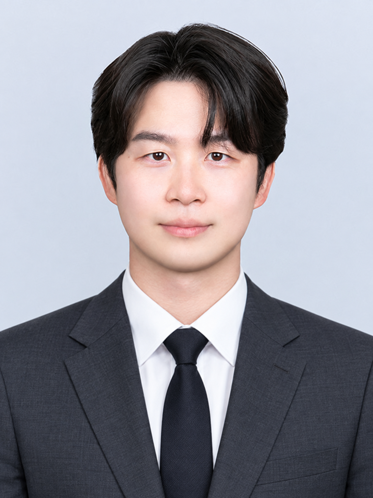

<table>
<tr>
<td width="170" align="center" valign="middle">

</td>
<td valign="middle">

# Han SeungHun

### RTL Design & Verification Engineer

**RTL을 설계하고, 시뮬레이션과 FPGA 동작을 근거로 검증합니다.**

[**Web Portfolio**](https://realisshoon.github.io/) · [**요약본 PDF 보기**](https://realisshoon.github.io/downloads/Han_SeungHun_Portfolio_Summary.pdf) · [**Notion**](https://app.notion.com/p/3fe61f29205481b29fa5f5446d9c1e0f) · [**Email**](mailto:hsgn21@naver.com)

</td>
</tr>
</table>

## About

- Verilog/SystemVerilog 기반 **FSM·Datapath·Peripheral RTL**을 설계하고, **UVM·Scoreboard·Functional Coverage·파형 분석**으로 검증했습니다.
- MicroBlaze와 AXI4-Lite Peripheral을 연결해 **MMIO 제어 → 버스 트랜잭션 → FPGA 동작**까지 확인했습니다.
- Python/Django Backend 업무와 Jetson 중앙 서버 개발 경험을 바탕으로 **데이터 흐름과 HW–SW Interface**를 함께 살펴봅니다.

## Featured Projects

### 01. CNN Motion Recognition SoC — 움이움

**2026.09.09–10.15 · 7인 팀 · 최종 발표·시연 완료**

카메라에서 사람의 움직임을 관측하고, PoseNet 0.75 기반 CNN RTL·임베디드 펌웨어를 거쳐 실제 로봇팔과 Unity 가상 로봇팔로 연결한 공동 프로젝트입니다. 발표 당시 시연과 현재 통합 소스의 재검증 상태를 구분해 기록합니다.

*팀 최종 발표자료의 실제 시연 GIF입니다. 최신 통합 코드의 보드 재검증 영상과는 구분합니다.*

**My Contribution**

- **DW/PW Convolution RTL:** 채널별 3×3 Depthwise와 1×1 Pointwise 연산, 정수 누산·재양자화, Weight 응답 및 출력 Handshake 처리.
- **Golden UVM 검증:** Python Golden과 RTL 결과를 비교하는 환경, 최종 관절 Register 비교 및 중간 연산 Checkpoint 분석. 수치 비교는 Sequence와 Python 비교 도구에서 수행합니다.
- **연동·가상 환경:** AXI4-Lite Peripheral 연동과 Unity 가상 환경 구축에 참여했습니다. 카메라·DMA·후처리·로봇 펌웨어·전체 시연은 팀 분담 결과입니다.

**확인한 RTL 검증 결과**

| 대상 | 2026.10.19 재검증 기록 | 원본 근거 |
|---|---|---|
| Depthwise Full-Layer TB | `Cin=96` · 3 batches · 27 taps · Weight expected/actual 27/27 · **errors=0, PASS** | [XSim 실행 로그](https://github.com/realisshoon/zynq-cnn-motion-robot-soc/blob/fc647991090b3955780308f7e371f94595f9bf7e/validation/step3/evidence/rtl_run_tb_depthwise_conv_pe_full_layer.txt) |
| Pointwise Directed TB | Arithmetic·Body/Heatmap/Offset·Tail Mask·Tag·출력/Weight Stall **PASS** | [XSim 실행 로그](https://github.com/realisshoon/zynq-cnn-motion-robot-soc/blob/fc647991090b3955780308f7e371f94595f9bf7e/validation/step3/evidence/rtl_run_tb_pointwise_conv_pe.txt) |
| Pointwise Fault/Recovery TB | Invalid Config·Protocol Mask·Reset Recovery·Fault 우선순위 **4/4 PASS, errors=0** | [XSim 실행 로그](https://github.com/realisshoon/zynq-cnn-motion-robot-soc/blob/fc647991090b3955780308f7e371f94595f9bf7e/validation/step3/evidence/rtl_run_tb_pointwise_conv_pe_fault.txt) |

위 결과는 **XSim 2020.2의 해당 모듈·입력 조건에 대한 단위 검증**입니다. 전체 Golden UVM 회귀는 입력 누락 등으로 재현에 남은 항목이 있으며, CNN 전체 PASS나 Coverage 100%로 확대하지 않습니다. 통합 검증의 PASS / FAIL / BLOCKED / NOT RUN은 [검증 요약](https://github.com/realisshoon/zynq-cnn-motion-robot-soc/blob/main/VALIDATION_SUMMARY.md)에서 확인할 수 있습니다.

[**Repository**](https://github.com/realisshoon/zynq-cnn-motion-robot-soc) · [**DW RTL**](https://github.com/realisshoon/zynq-cnn-motion-robot-soc/blob/main/CNN/rtl/depthwise_conv_pe.v) · [**PW RTL**](https://github.com/realisshoon/zynq-cnn-motion-robot-soc/blob/main/CNN/rtl/pointwise_conv_pe.v) · [**Golden UVM**](https://github.com/realisshoon/zynq-cnn-motion-robot-soc/tree/main/CNN/uvm/golden) · [**Portfolio**](https://realisshoon.github.io/projects/cnn-motion-soc.html)

---

<table>
<tr>
<td width="50%" valign="top">

### 02. FPGA VGA 지휘게임

`SystemVerilog` `UVM` `OV7670` `UART`

카메라로 지휘봉·손 표식을 검출하고 음악의 박자·속도·음량을 제어한 **7인 팀 프로젝트**입니다.

**My Contribution**

- RGB Filter RTL, 좌표 검출 모듈 연동
- Top RTL 및 FPGA–PC 통합
- RGB Detect UVM, 저장소·브랜치 통합

**Evidence**

RGB 채널의 임계값·색상 간 Margin과 좌표 출력 Handshake를 구현·검증했습니다. Scoreboard에서 Expected/Actual 좌표·프레임·타이밍을 비교합니다.

[**Repository / Demo**](https://github.com/realisshoon/fpga-vga-conductor-game) · [**UVM Source**](https://github.com/realisshoon/fpga-vga-conductor-game/tree/main/tb/uvm/uvm_rg_detect)

</td>
<td width="50%" valign="top">

### 03. AXI4-Lite Multi-Peripheral SoC

`AXI4-Lite` `MicroBlaze` `UVM` `Vitis C`

GPIO·UART·Timer·I2C LCD·SPI를 MicroBlaze에 연결한 **개인 프로젝트**입니다.

**My Contribution**

- Peripheral RTL·Address Map·Register Interface
- AXI-SPI UVM 환경과 Scoreboard/Coverage
- Vitis MMIO 제어 및 Basys3 보드 검증

**Verified Result**

AXI-SPI UVM **32 Pass / 0 Fail**, 정의한 Functional Coverage **100%**. TXDATA·START·DONE·SPI 완료의 4개 Covergroup 기준이며, SoC 전체·Code Coverage 수치가 아닙니다.

[**Repository / Result**](https://github.com/realisshoon/axi4-lite-multi-peripheral-soc#verification) · [**Coverage 정의**](https://github.com/realisshoon/axi4-lite-multi-peripheral-soc/blob/main/verification/spi_uvm/tb/coverage.sv)

</td>
</tr>
<tr>
<td width="50%" valign="top">

### 04. SPI / I2C RTL & UVM

`SystemVerilog` `SPI` `I2C` `UVM`

두 Protocol의 RTL·UVM·보드 통신을 직접 수행한 **개인 프로젝트**입니다.

**My Contribution**

- SPI/I2C Master·Slave RTL 및 송수신 FSM·데이터 경로 설계
- UVM 환경·Scoreboard·Functional Coverage 구성
- I2C ACK Sampling 수정과 FPGA 보드 간 통신 검증

**Verification Result**

- SPI: **48 Pass / 0 Fail · Functional Coverage 59.59%**
- I2C: **14 Pass / 0 Fail · Functional Coverage 100%**

각 Protocol에서 정의한 Coverpoint 기준의 기존 검증 결과입니다.

[**Repository / Result**](https://github.com/realisshoon/spi_i2c_uvm) · [**SPI RTL**](https://github.com/realisshoon/spi_i2c_uvm/tree/main/spi/rtl)

</td>
<td width="50%" valign="top">

### 05. RV32I Single-Cycle CPU

`SystemVerilog` `RISC-V` `FSM / Datapath`

RV32I 명령을 처리하는 Single-Cycle CPU를 구현한 **개인 프로젝트**입니다.

**My Contribution**

- PC·Register File·ALU·Immediate Generator
- Control Unit·Memory·CPU/SoC Top 연결
- Instruction별 Directed Test와 Bubble Sort

**Evidence**

제출 당시 배열 `{3,5,0,1,7}` → `{0,1,3,5,7}` 정렬 결과를 파형·Memory로 확인했습니다. 현재 보존 소스의 `pc_en` 연결 누락과 재컴파일 한계는 저장소에 명시했습니다.

[**Repository / Result**](https://github.com/realisshoon/RV32i-CPU#verification-result) · [**Source Status**](https://github.com/realisshoon/RV32i-CPU#archived-source-status)

</td>
</tr>
</table>

## Design & Verification Approach

| 경험 | 구현·검증에서 확인한 내용 | 근거 |
|---|---|---|
| **CNN 정수 연산 비교** | G01에서 17개 관절 Register와 Metadata를 비교하고, G02 도구에서 TAG·MASK·DATA를 해석해 29개 연산 Tensor를 원소별 비교합니다. 비교 코드와 실행 결과를 구분합니다. | [G01 Sequence](https://github.com/realisshoon/zynq-cnn-motion-robot-soc/blob/main/CNN/uvm/golden/sequences/cnn_g01_e2e_seq.sv) · [G02 Comparator](https://github.com/realisshoon/zynq-cnn-motion-robot-soc/blob/main/CNN/uvm/golden/golden_io/compare_g02_checkpoints.py) |
| **DW Weight / Stall 처리** | Weight 요청을 1개 Outstanding으로 제한하고 Holding Register로 응답과 Tap 입력을 분리합니다. 출력이 막히면 Data·Mask·Tag를 함께 유지하는 구조입니다. | [Depthwise RTL](https://github.com/realisshoon/zynq-cnn-motion-robot-soc/blob/main/CNN/rtl/depthwise_conv_pe.v) |
| **VGA 색상·좌표 검증** | 단일 채널 임계값뿐 아니라 채널 간 Margin을 비교하고, Expected/Actual Queue로 좌표·프레임·Handshake 시점을 확인합니다. | [RGB Filter](https://github.com/realisshoon/fpga-vga-conductor-game/blob/main/rtl/filter_detect/rgb_filter.sv) · [Scoreboard](https://github.com/realisshoon/fpga-vga-conductor-game/blob/main/tb/uvm/uvm_rg_detect/rg_detect_scoreboard.sv) |

## Technical Skills

각 기술의 수행 범위는 위 프로젝트의 코드·검증 근거에서 확인할 수 있습니다.

| 분야 | 실제 사용 기술·도구 |
|---|---|
| **RTL Design & Verification** | Verilog / SystemVerilog, FSM·Datapath·Peripheral RTL, UVM, Scoreboard, Functional Coverage, VCS / Verdi, Vivado / XSim |
| **SoC / Embedded** | AXI4-Lite, MicroBlaze, MMIO / Register Control, Embedded C / Vitis, FPGA 및 HW–SW Integration |
| **AI / Computer Vision** | Python, Jetson, YOLO 기반 시스템 연동, Multi-Camera Tracking / Re-ID 데이터 처리 |
| **Software / Backend** | Python / Django, Database, API Integration, MQTT, Linux, 데이터 처리·자동화 |

## Additional Projects

| 분야 | 프로젝트 | 개인 수행 범위·자료 |
|---|---|---|
| RTL / Verification | [UART / FIFO OOP Verification](https://github.com/realisshoon/UART_OOP_Verification) | Transaction·Driver·Monitor·Scoreboard 기반 Self-checking TB, UART/FIFO 단위 및 RX+FIFO 통합 검증 |
| SoC / Embedded | [UART / FIFO / Sensor FPGA System](https://github.com/realisshoon/UART_FIFO_SENSOR_CLOCK) | SR04·DHT11 Controller/Datapath·TB, Watch/Stopwatch Datapath, 2-stage Input Synchronizer |
| RTL Design | [Stopwatch / Watch](https://github.com/realisshoon/STOPWATCH-WATCH_Verilog-HDL) | FSM·Control Unit, FND MUX/Decoder·자리 표시, 통합 Mode 검증. Datapath Counter는 팀 담당 |
| AI / System Integration | [Jetson Multi-Camera Tracking & Re-ID](https://github.com/realisshoon/jetson-multicam-re_id-tracking) | 중앙 서버·DB·MQTT 연동, 4대 Jetson 시스템 통합. 탐지·Re-ID 모델 성과는 팀 결과 |

---

**한승훈 · Han SeungHun** 
[Web Portfolio](https://realisshoon.github.io/) · [요약본 PDF](https://realisshoon.github.io/downloads/Han_SeungHun_Portfolio_Summary.pdf) · [Notion](https://app.notion.com/p/ace61f2920548207b58d01260d14c80a) · [hsgn21@naver.com](mailto:hsgn21@naver.com)
